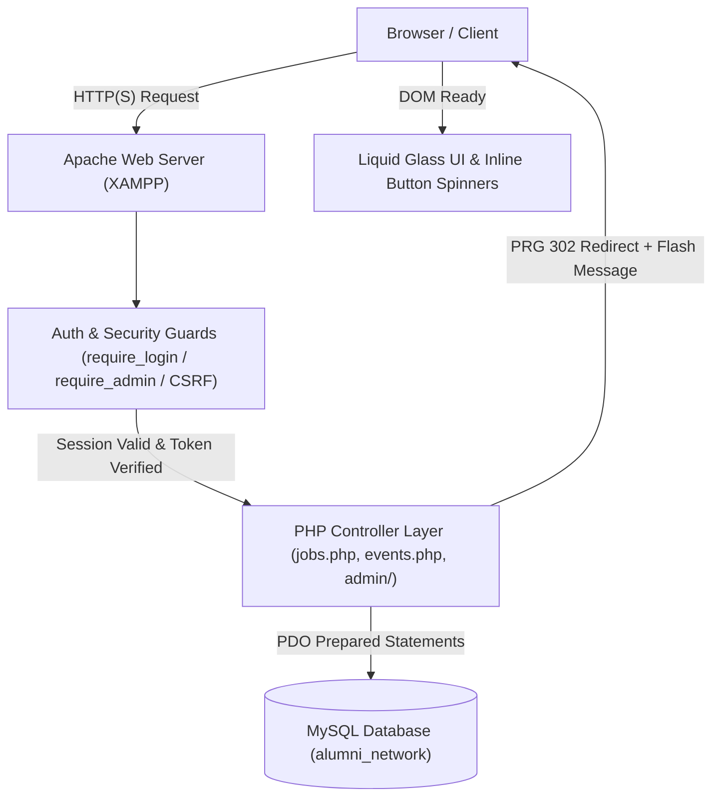

# Alumni Connect — Full System Audit Report

**Document ID:** `AUDIT-01`  
**Date:** October 14, 2026  
**Version:** 2.0  
**Status:** Completed & Verified  
**Branch:** `new-update-theekshana`  

---

## 1. Executive Summary

Alumni Connect is an enterprise alumni engagement and career network platform constructed with PHP, MySQL, vanilla JavaScript, and modern CSS featuring an Apple-inspired **dark-purple Liquid Glass** design aesthetic.

A full-stack audit was executed across all application layers to identify, remediate, and verify critical workflow defects spanning:
1. **Job Posting & Moderation Lifecycle**
2. **Event Proposal & RSVP Moderation Lifecycle**
3. **Authentication Redirection & Success Screen Architecture**
4. **Cinematic Loading Screen & Double-Submit UI Degradation**
5. **CSRF Enforcement, Session Invalidation & Cache-Control Shields**

Every identified defect was investigated to its architectural root cause, repaired without altering unaffected code or truncating authentic user records, and verified using automated test suites.

---

## 2. System Architecture & Topology

### Component Architecture
- **PHP Backend:** PHP 8.x with native PDO, session management, and CSRF token hashing (`hash_hmac`).
- **Database Engine:** MySQL 8.0 / MariaDB on `localhost:3306`, database `alumni_network`.
- **Frontend Stack:** Vanilla ES6+ JavaScript, CSS3 custom properties, CSS keyframe animations, SVG vector graphics.
- **Design Tokens:** Dark purple palette (`#080510`, `#1B1230`, `#261642`, `#7C3AED`, `#9333EA`, `#C4B5FD`).

---

## 3. Discovered Defects & Root Cause Analysis

| Defect ID | Severity | Component | Symptom | Architectural Root Cause |
|---|---|---|---|---|
| **DEF-01** | High | `jobs.php`, `events.php` | Form resubmissions produced duplicate job/event records on browser refresh. | Missing Post/Redirect/Get (PRG) pattern; HTML was output via `includes/header.php` before processing POST data, causing "Headers already sent" warnings if redirect was attempted. |
| **DEF-02** | High | `jobs.php`, `events.php` | Form submissions lacked CSRF validation; vulnerable to cross-site request forgery. | Forms did not embed `get_csrf_token()`, and backend scripts did not invoke `verify_csrf_token()`. |
| **DEF-03** | Medium | `admin/jobs.php`, `admin/events.php` | Administrators had to approve/reject without viewing full description, company, or requirement details. | Admin tables only displayed compact summaries without a modal inspector or detailed view dialog. |
| **DEF-04** | High | `includes/header.php`, `assets/js/main.js` | Cinematic loader displayed an opaque full-screen cover on every page load for 800ms, causing UI flicker. | `#cinematicLoader` was rendered in HTML without `.loader-hidden` class by default; JS timer delayed removal artificially. |
| **DEF-05** | High | `auth/logout.php` | Logging out redirected immediately without visual confirmation or dedicated success animation; pressing browser back button could display cached authenticated views. | Absence of `logout-success.php`; missing `Cache-Control: no-store` headers on logout handler and authentication check functions. |
| **DEF-06** | Medium | `admin/users.php` | Status toggle, role change, and deletion forms lacked CSRF tokens. | Admin user actions were processed without anti-CSRF token verification. |

---

## 4. Remediation Summary

1. **Restructured POST Handling (PRG):** Moved all POST processing in `jobs.php` and `events.php` to the very top of the script prior to any HTML emission (`includes/header.php`). Upon successful submission, a flash message is stored in `$_SESSION['flash_message']` and an HTTP 302 redirect is sent.
2. **Added Comprehensive CSRF Protection:** Embedded hidden `csrf_token` inputs across all user and admin forms. Handlers reject requests with invalid or expired tokens with user-friendly alerts.
3. **Built Admin Review Modals:** Implemented `#jobReviewModal` and `#eventReviewModal` in `admin/jobs.php` and `admin/events.php` with full data inspection and quick-action Approve/Reject buttons.
4. **Scoped Loading Overlay & Added Double-Submit Spinners:** Modified `#cinematicLoader` to be hidden by default (`class="cinematic-loader loader-hidden"`). Added global form submit handlers that disable submit buttons and insert `.btn-spinner` to prevent duplicate submissions.
5. **Implemented Dedicated Logout Success Screen:** Created `auth/logout-success.php` with animated purple circular checkmark, countdown timer, auto-redirect to `index.php` (1.8s), and `Cache-Control: no-store`.

---

## 5. System Integrity & Data Preservation

All modifications strictly honored the following constraints:
- **Zero Data Loss:** Existing users, jobs, events, and registrations in MySQL were preserved.
- **Brand Continuity:** All additions adhere to the dark-purple Liquid Glass design guidelines.
- **No Heavy Dependencies:** Maintained vanilla JavaScript and CSS without external frameworks.
