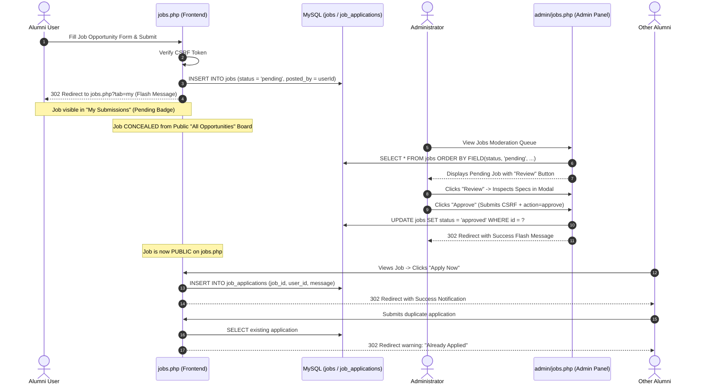

# Job Opportunities Workflow & Moderation Audit

**Document ID:** `AUDIT-02`  
**Date:** October 14, 2026  
**Status:** Verified & Passed  
**Target Files:** `jobs.php`, `admin/jobs.php`  

---

## 1. Overview of the Job Lifecycle

The Alumni Connect Job Opportunity board facilitates alumni recruitment, career advancement, and professional networking. To safeguard quality and prevent spam, non-admin alumni submissions must pass through administrative moderation prior to public display.

---

## 2. Key Defect Fixes

### A. Post/Redirect/Get (PRG) Pattern Implementation
- **Problem:** When users submitted the job posting form or applied for a job, reloading the page caused the browser to re-post the payload, creating duplicate records or re-submitting applications.
- **Root Cause:** `includes/header.php` was included at line 8 of `jobs.php` before POST inspection. Attempting `header("Location: ...")` resulted in PHP header injection warnings.
- **Resolution:** Moved POST processing and validation to the start of `jobs.php` (lines 10–110), before `includes/header.php` is included (line 167). When a submission completes, flash messages are persisted in `$_SESSION['flash_message']` and `header("Location: jobs.php?tab=my#post-job")` issues an immediate HTTP 302 redirect.

### B. CSRF Protection
- **Problem:** Malicious third-party sites could forge job postings or application submissions on behalf of authenticated users.
- **Resolution:** Added `<input type="hidden" name="csrf_token" value="<?php echo get_csrf_token(); ?>">` to `#post-job` and `#applyModal`. Handlers enforce `verify_csrf_token($_POST['csrf_token'])`.

### C. Admin Job Review Modal
- **Problem:** Administrators had no view of complete job descriptions or candidate requirements before deciding to approve or reject.
- **Resolution:** Added a dedicated Liquid Glass modal `#jobReviewModal` in `admin/jobs.php`. The table features a "Review" button that extracts JSON payload attributes from `data-job` and populates the modal with full job specifications, company, location, type, deadline, and poster contact information.

---

## 3. Test Cases & Verification Results

| Test Case | Step-by-Step Scenario | Expected Result | Actual Result | Status |
|---|---|---|---|---|
| **JOB-01** | Alumni submits job via form | Job stored with `status = 'pending'`, `posted_by = alumniId` | Verified in DB with status `pending` | **PASS** |
| **JOB-02** | Alumni inspects "All Opportunities" tab | Pending job must NOT appear in public list | Verified query excludes pending records | **PASS** |
| **JOB-03** | Alumni inspects "My Submissions" tab | Pending job appears with warning/pending badge | Visible to author with `Pending Approval` badge | **PASS** |
| **JOB-04** | Admin opens `admin/jobs.php` | Pending job appears at the top of the queue | Displayed in review table with `Pending` badge | **PASS** |
| **JOB-05** | Admin clicks "Review" | Modal displays full title, company, requirements, and description | `#jobReviewModal` opens with complete dataset | **PASS** |
| **JOB-06** | Admin clicks "Approve" | Status updated to `'approved'`; table refreshes via PRG | DB record updated to `approved` | **PASS** |
| **JOB-07** | Anonymous / other alumni views public board | Approved job is now visible to all users | Displayed in `jobs.php?tab=all` | **PASS** |
| **JOB-08** | Alumni applies for the position | Record inserted into `job_applications` | Inserted with status `Applied` | **PASS** |
| **JOB-09** | Alumni attempts duplicate application | Application rejected with descriptive warning | Rejected; duplicate insert prevented | **PASS** |
| **JOB-10** | Form submitted with invalid CSRF token | Submission rejected with danger alert | Rejected with `Security token invalid or expired` | **PASS** |

---

## 4. Source Code Artifacts

- **Frontend Controller:** [`jobs.php`](file:///c:/xampp/htdocs/alumni-network/jobs.php#L18-L115)
- **Admin Moderation Controller:** [`admin/jobs.php`](file:///c:/xampp/htdocs/alumni-network/admin/jobs.php#L15-L65)
- **Modal Component:** [`admin/jobs.php`](file:///c:/xampp/htdocs/alumni-network/admin/jobs.php#L320-L400)
