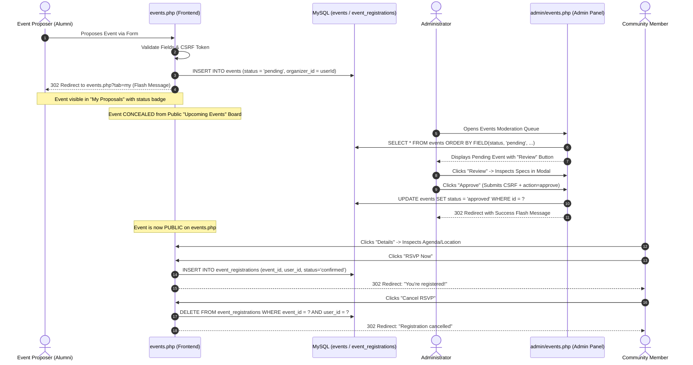

# Event Proposals, RSVP & Moderation Workflow Audit

**Document ID:** `AUDIT-03`  
**Date:** October 14, 2026  
**Status:** Verified & Passed  
**Target Files:** `events.php`, `admin/events.php`  

---

## 1. Overview of the Event Lifecycle

Alumni Connect enables alumni and staff to organize reunions, webinars, networking sessions, and career workshops. Community proposals are queued for administrative moderation before publication to prevent scheduling conflicts and spam.

---

## 2. Key Defect Fixes

### A. Post/Redirect/Get (PRG) Pattern Implementation
- **Problem:** When users submitted event proposals or toggled RSVPs, reloading the page triggered duplicate database inserts.
- **Root Cause:** Output was initiated via `includes/header.php` before handling POST requests, preventing clean HTTP redirects.
- **Resolution:** Re-ordered `events.php` logic so that POST handling (lines 18–140) executes before `includes/header.php` is included (line 218). All successful submissions and RSVP toggles issue an HTTP 302 redirect with session flash messaging.

### B. CSRF Protection on Event & RSVP Forms
- **Problem:** Event proposals, RSVP toggles, and report submissions were vulnerable to cross-site request forgery.
- **Resolution:** Embedded CSRF tokens in `#propose-event`, RSVP toggle buttons, report modals, and details dialogs. Handlers enforce strict validation via `verify_csrf_token()`.

### C. Liquid Glass Event Details & Review Modals
- **Problem:** Public users could not view complete event agendas without navigating away; administrators could not inspect full event details prior to approving/rejecting.
- **Resolution:** 
  1. Built `#eventDetailsModal` on `events.php` with event type badge, date/time formatting, venue details, capacity progress bar, organizer bio, and direct RSVP action button.
  2. Built `#eventReviewModal` in `admin/events.php` for administrative inspection of event metadata, organizer email, capacity limits, and descriptions.

---

## 3. Test Cases & Verification Results

| Test Case | Step-by-Step Scenario | Expected Result | Actual Result | Status |
|---|---|---|---|---|
| **EVT-01** | Alumni submits event proposal | Event stored with `status = 'pending'`, `organizer_id = alumniId` | Verified in DB with status `pending` | **PASS** |
| **EVT-02** | Alumni inspects "Upcoming Events" tab | Pending event must NOT appear on public board | Verified query excludes pending records | **PASS** |
| **EVT-03** | Alumni inspects "My Proposals" tab | Pending event appears with `Pending Approval` badge | Visible to author with pending status badge | **PASS** |
| **EVT-04** | Admin opens `admin/events.php` | Pending event appears at the top of moderation queue | Displayed in moderation table | **PASS** |
| **EVT-05** | Admin clicks "Review" | Modal displays full title, date, time, venue, capacity, and description | `#eventReviewModal` opens with complete dataset | **PASS** |
| **EVT-06** | Admin clicks "Approve" | Status updated to `'approved'`; table refreshes via PRG | DB record updated to `approved` | **PASS** |
| **EVT-07** | Public board accessed | Approved event is now visible to all users | Displayed in `events.php?tab=all` | **PASS** |
| **EVT-08** | Attendee opens event details modal | Details modal displays full specifications and RSVP button | `#eventDetailsModal` opens correctly | **PASS** |
| **EVT-09** | Attendee clicks "RSVP Now" | Record inserted into `event_registrations` with status `'confirmed'` | Verified insert in DB | **PASS** |
| **EVT-10** | Attendee clicks "Cancel RSVP" | Record deleted from `event_registrations` | Record removed; button resets to "RSVP Now" | **PASS** |
| **EVT-11** | Proposal submitted with invalid CSRF token | Action rejected with danger alert | Rejected with `Security token invalid or expired` | **PASS** |

---

## 4. Source Code Artifacts

- **Frontend Controller:** [`events.php`](file:///c:/xampp/htdocs/alumni-network/events.php#L18-L140)
- **Public Event Details Modal:** [`events.php`](file:///c:/xampp/htdocs/alumni-network/events.php#L420-L490)
- **Admin Moderation Controller:** [`admin/events.php`](file:///c:/xampp/htdocs/alumni-network/admin/events.php#L15-L65)
- **Admin Event Review Modal:** [`admin/events.php`](file:///c:/xampp/htdocs/alumni-network/admin/events.php#L310-L380)
