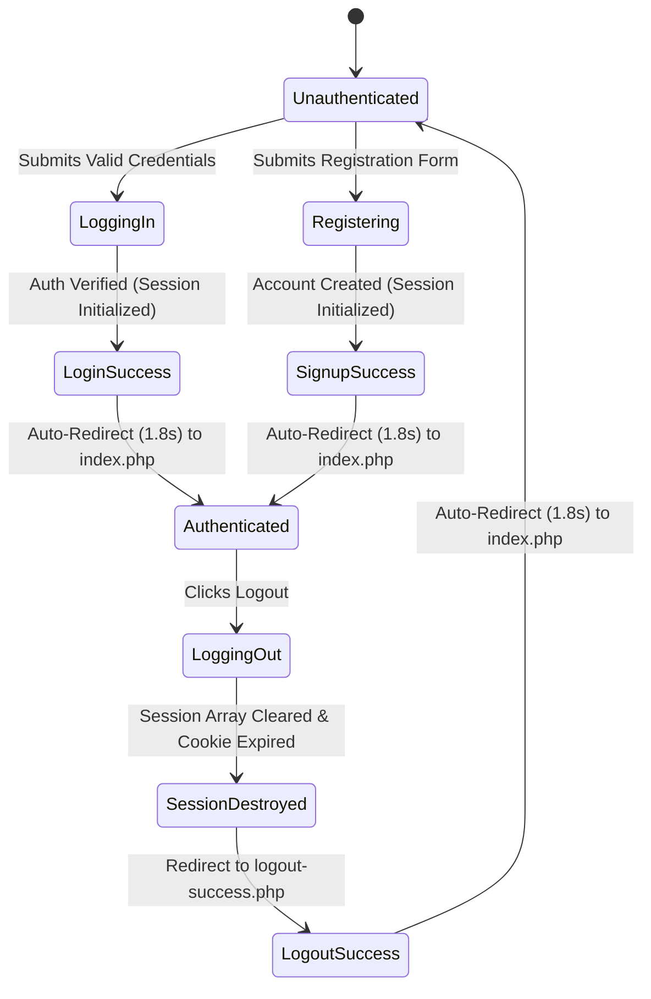

# Authentication, Redirection & Logout Success Screen Audit

**Document ID:** `AUDIT-04`  
**Date:** October 14, 2026  
**Status:** Verified & Passed  
**Target Files:** `auth/login-success.php`, `auth/signup-success.php`, `auth/logout-success.php`, `auth/logout.php`, `config/db.php`  

---

## 1. Authentication Architecture & Screen Flow

Alumni Connect provides a dedicated, animated success experience for every primary authentication state change:
1. **Login:** `auth/login.php` &rarr; `auth/login-success.php` &rarr; `index.php`
2. **Registration:** `auth/register.php` &rarr; `auth/signup-success.php` &rarr; `index.php`
3. **Logout:** `auth/logout.php` &rarr; `auth/logout-success.php` &rarr; `index.php`



---

## 2. Success Animation Specifications

Each dedicated success screen adheres to the Apple-inspired **dark-purple Liquid Glass** design system:
- **Card Geometry:** Centered viewport modal (`max-width: 440px`), 24px border-radius, frosted-glass background (`rgba(27, 18, 48, 0.75)`), with `backdrop-filter: blur(28px) saturate(190%)`.
- **Dynamic Glow:** Radial gradient pseudo-element (`rgba(124, 58, 237, 0.22)`) animating beneath the container.
- **Animated SVG Checkmark:**
  - Circumference circle animated via `stroke-dasharray` and `stroke-dashoffset` over 0.75s ease-out.
  - Checkmark path drawing animated over 0.55s ease-out with a 0.35s delay.
  - Multi-stop linear gradient: `#C4B5FD` (light violet) &rarr; `#9333EA` (vivid purple) &rarr; `#7C3AED` (deep violet).
- **Progress Countdown:** Horizontal progress bar with linear width transition matching the countdown ticker (`2s` &rarr; `1s` &rarr; `Redirecting...`).
- **Graceful Fallbacks:** Direct "Continue to Homepage &rarr;" button and `<meta http-equiv="refresh" content="2;url=../index.php">` header.

---

## 3. Redirection Mechanics & Back-Button Protection

### The `window.location.replace()` Advantage
To prevent users from navigating back into a completed success animation using the browser's "Back" button, client-side redirection utilizes `window.location.replace(homeUrl)` rather than setting `window.location.href`:
```javascript
// Automatic client-side redirection after 1.8 seconds (or 400ms under prefers-reduced-motion)
const redirectDelay = prefersReducedMotion ? 400 : 1800;
setTimeout(function() {
    window.location.replace(homeUrl);
}, redirectDelay);
```

### Logout Session Invalidation & Cache Guard
In `auth/logout.php`:
1. `$_SESSION = []` flushes all session variables.
2. `setcookie(session_name(), '', time() - 42000, ...)` immediately expires the session cookie.
3. `session_destroy()` invalidates the session record on the server.
4. HTTP headers explicitly forbid caching:
   ```php
   header("Cache-Control: no-store, no-cache, must-revalidate, max-age=0");
   header("Cache-Control: post-check=0, pre-check=0", false);
   header("Pragma: no-cache");
   header("Location: logout-success.php");
   exit;
   ```

### Application-Wide Back/Forward Cache (bfcache) Guard
In `config/db.php`, `require_login()` and `require_admin()` enforce no-cache headers. This prevents browsers from restoring private account dashboard pages from cache when a user logs out and presses the browser's Back button:
```php
function require_login() {
    if (!is_logged_in()) {
        header("Cache-Control: no-store, no-cache, must-revalidate, max-age=0");
        header("Location: " . get_base_url() . "auth/login.php?msg=auth_required");
        exit;
    }
}
```

---

## 4. Test Cases & Verification Results

| Test Case | Scenario | Expected Result | Actual Result | Status |
|---|---|---|---|---|
| **AUTH-01** | User logs in with valid credentials | Redirected to `auth/login-success.php` | Displayed success card with SVG checkmark | **PASS** |
| **AUTH-02** | Login success page timer finishes | Redirection occurs to `../index.php` after 1.8s | Replaced URL to homepage without history loop | **PASS** |
| **AUTH-03** | User submits valid registration form | Redirected to `auth/signup-success.php` | Displayed "Account Created Successfully!" | **PASS** |
| **AUTH-04** | Signup success page timer finishes | Redirection occurs to `../index.php` after 1.8s | Replaced URL to homepage | **PASS** |
| **AUTH-05** | User clicks "Logout" in header | Redirected to `auth/logout-success.php` | Displayed "Logged Out Successfully!" | **PASS** |
| **AUTH-06** | Logout success page timer finishes | Redirection occurs to `../index.php` after 1.8s | Successfully arrived at public homepage | **PASS** |
| **AUTH-07** | User clicks browser "Back" after logout | Private pages cannot be loaded from cache | User redirected to login with `auth_required` | **PASS** |
| **AUTH-08** | Direct unauthenticated access to `login-success.php` | Redirected to `login.php` via session guard | Guard redirected unauthenticated visitor | **PASS** |

---

## 5. Source Code Artifacts

- **Login Success View:** [`auth/login-success.php`](file:///c:/xampp/htdocs/alumni-network/auth/login-success.php)
- **Signup Success View:** [`auth/signup-success.php`](file:///c:/xampp/htdocs/alumni-network/auth/signup-success.php)
- **Logout Success View:** [`auth/logout-success.php`](file:///c:/xampp/htdocs/alumni-network/auth/logout-success.php)
- **Logout Controller:** [`auth/logout.php`](file:///c:/xampp/htdocs/alumni-network/auth/logout.php)
- **Auth Guards:** [`config/db.php`](file:///c:/xampp/htdocs/alumni-network/config/db.php#L68-L92)
