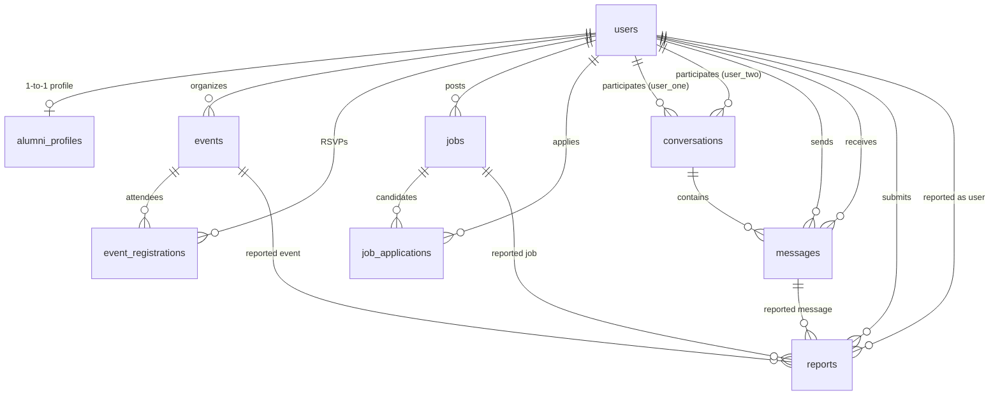

# 02 — Entity Relationships and Foreign Key Constraints

## Entity Relationship Architecture

The Alumni Connect relational model is organized around the central `users` entity with strong referential integrity, cascading delete policies, and unique constraints to prevent duplicate associations.



---

## 1. Foreign Key Specifications Matrix

| Parent Table | Parent Key | Child Table | Child Foreign Key | Action on Parent Delete | Action on Parent Update | Business Justification |
| :--- | :--- | :--- | :--- | :---: | :---: | :--- |
| `users` | `id` | `alumni_profiles` | `user_id` | **CASCADE** | **RESTRICT** | Deleting a user must immediately purge their profile details |
| `users` | `id` | `events` | `organizer_id` | **CASCADE** | **RESTRICT** | Deleting a member removes events hosted by that member |
| `events` | `id` | `event_registrations` | `event_id` | **CASCADE** | **RESTRICT** | If an event is cancelled/deleted, all RSVPs are cleanly cleared |
| `users` | `id` | `event_registrations` | `user_id` | **CASCADE** | **RESTRICT** | If a user is removed, their RSVP attendance slots are freed |
| `users` | `id` | `jobs` | `posted_by` | **CASCADE** | **RESTRICT** | If an employer/alumnus account is deleted, their postings are purged |
| `jobs` | `id` | `job_applications` | `job_id` | **CASCADE** | **RESTRICT** | Deleting a job vacancy clears candidate submissions |
| `users` | `id` | `job_applications` | `user_id` | **CASCADE** | **RESTRICT** | Deleting an applicant account purges their applications |
| `users` | `id` | `conversations` | `user_one_id` | **CASCADE** | **RESTRICT** | If either participant is deleted, the conversation thread closes |
| `users` | `id` | `conversations` | `user_two_id` | **CASCADE** | **RESTRICT** | If either participant is deleted, the conversation thread closes |
| `conversations`| `id` | `messages` | `conversation_id` | **CASCADE** | **RESTRICT** | Removing a thread removes all constituent messages |
| `users` | `id` | `messages` | `sender_id` | **CASCADE** | **RESTRICT** | Messages sent by deleted users are cleared |
| `users` | `id` | `messages` | `receiver_id` | **CASCADE** | **RESTRICT** | Messages directed to deleted users are cleared |
| `users` | `id` | `reports` | `reporter_id` | **CASCADE** | **RESTRICT** | Reports submitted by deleted users are cleared |
| `users` | `id` | `reports` | `reported_user_id`| **CASCADE** | **RESTRICT** | Reports on deleted users are resolved automatically |
| `events` | `id` | `reports` | `event_id` | **CASCADE** | **RESTRICT** | Reports on deleted events are resolved automatically |
| `jobs` | `id` | `reports` | `job_id` | **CASCADE** | **RESTRICT** | Reports on deleted jobs are resolved automatically |
| `messages` | `id` | `reports` | `message_id` | **CASCADE** | **RESTRICT** | Reports on deleted messages are resolved automatically |

---

## 2. Integrity and Uniqueness Rules

### A. Conversation Thread Deduplication
To prevent two duplicate threads between the same two users (e.g. John &rarr; Sarah vs Sarah &rarr; John), the system enforces:
1. Canonical ordering on insertion: `user_one_id = min($sender, $receiver)` and `user_two_id = max($sender, $receiver)`.
2. Database uniqueness constraint:
   ```sql
   UNIQUE KEY unique_participants (user_one_id, user_two_id)
   ```
   This guarantees that exactly one row exists in `conversations` for any pair of alumni.

### B. Event RSVP Deduplication
Members are prevented from generating redundant RSVP records for the same event:
```sql
UNIQUE KEY unique_registration (event_id, user_id)
```
When a member cancels their attendance, the application updates `status = 'cancelled'`. When they re-register, it updates `status = 'attending'`, preserving a clean single-row history.

### C. Job Application Deduplication
Job candidates cannot submit duplicate applications for the same opening:
```sql
UNIQUE KEY unique_application (job_id, user_id)
```
Subsequent application attempts are intercepted by the API with a user-friendly `Already Applied` notice.

---

## 3. Referential Cascade Safety Safeguards

In administrative operations:
* **Primary Admin Protection**: User ID 1 (`admin`) is protected in PHP code (`admin/users.php` line 25: `if ($targetUserId === 1)`) from deletion or suspension.
* **Self-Action Prevention**: Active administrators cannot suspend or delete their own sessions (`if ($targetUserId === $currentAdminId)`).
* **Safe Unsend (Soft Delete)**: When an author unsends a message, the record is not deleted from the table; instead, `is_unsent = 1` and `unsent_at = NOW()` are recorded, preserving foreign-key referential integrity for report moderation.
